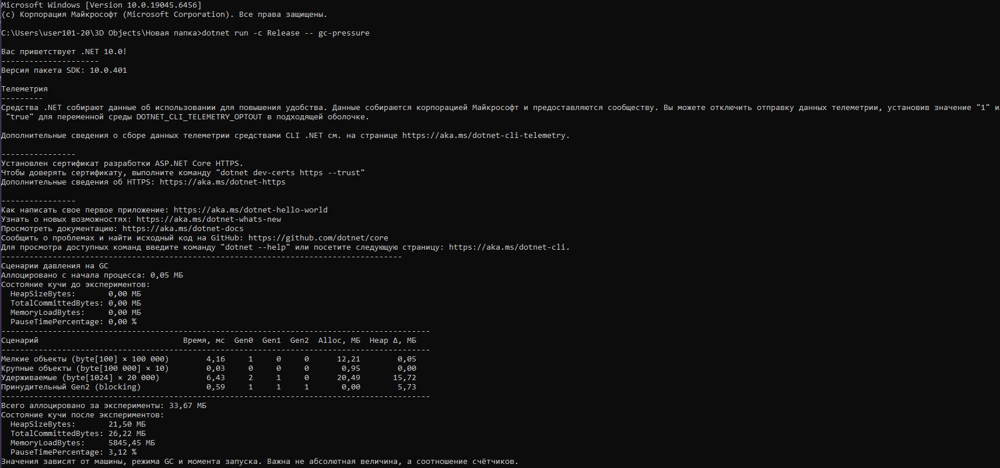

# КТ №40. GC в .NET 10: поколения, регионы памяти (DATAS)

> **Вариант 2 — «Измерение давления»**
> Команда запуска: `dotnet run -c Release -- gc-pressure`

## Цель

Научиться наблюдать за работой сборщика мусора .NET из кода и объяснять, как
время жизни и размер объектов влияют на поколения (Gen0/Gen1/Gen2), LOH и
объём аллокаций.

## Задачи

1. Зафиксировать `GC.GetTotalAllocatedBytes()` в начале работы.
2. Выполнить сценарии в отдельных методах, снимая показания **до и после** каждого:
   - много мелких объектов — `byte[100]` × 100 000;
   - несколько крупных объектов — `byte[100_000]` × 10;
   - удержание долгоживущих объектов в статическом списке — `byte[1024]` × 20 000.
3. Вывести разницу аллоцированных байт для каждого сценария (в МБ).
4. Вывести счётчики Gen0 и Gen2 и объяснить в комментариях к коду, почему цифры отличаются.

## Реализация

| Файл | Назначение |
|---|---|
| `Gc/GcSnapshot.cs` | `record struct` со снимком `CollectionCount(0/1/2)`, `GetTotalAllocatedBytes(precise: true)`, `HeapSizeBytes`; метод `Diff()` считает прирост |
| `Gc/GcObserver.cs` | Печать состояния кучи по `GC.GetGCMemoryInfo()` |
| `Gc/PressureScenarios.cs` | Четыре сценария + табличный вывод |
| `Program.cs` | Команда `gc-pressure` |

Ключевые решения:

- каждый сценарий — **отдельный метод**, снимок `GcSnapshot.Capture()` берётся до и после, поэтому эффекты не смешиваются;
- результат мелких аллокаций используется (`checksum` + `GC.KeepAlive`), чтобы JIT не выкинул цикл;
- крупные массивы удерживаются списком `retained` + `GC.KeepAlive`;
- долгоживущие объекты хранятся в `static List<byte[]>`;
- четвёртый сценарий — `GC.Collect(2, GCCollectionMode.Forced, blocking: true)` — показывает, как выглядит реальная сборка Gen2.

## Результаты

**Условия запуска:** Windows 10 (build 19045.6456), .NET SDK 10.0.401, конфигурация `Release`, Workstation GC (по умолчанию).

| Сценарий | Время, мс | Gen0 | Gen1 | Gen2 | Alloc, МБ | Heap Δ, МБ |
|---|---:|---:|---:|---:|---:|---:|
| Мелкие объекты (`byte[100]` × 100 000) | 4,16 | 1 | 0 | 0 | 12,21 | 0,05 |
| Крупные объекты (`byte[100 000]` × 10) | 0,03 | 0 | 0 | 0 | 0,95 | 0,00 |
| Удерживаемые (`byte[1024]` × 20 000) | 6,43 | 2 | 1 | 0 | 20,49 | 15,72 |
| Принудительный Gen2 (blocking) | 0,59 | 1 | 1 | 1 | 0,00 | 5,73 |

Полный вывод программы:

```text
Сценарии давления на GC
Аллоцировано с начала процесса: 0,05 МБ
Состояние кучи до экспериментов:
  HeapSizeBytes:       0,00 МБ
  TotalCommittedBytes: 0,00 МБ
  MemoryLoadBytes:     0,00 МБ
  PauseTimePercentage: 0,00 %
--------------------------------------------------------------------------------------------
Сценарий                               Время, мс  Gen0  Gen1  Gen2  Alloc, МБ  Heap Δ, МБ
--------------------------------------------------------------------------------------------
Мелкие объекты (byte[100] × 100 000)        4,16     1     0     0      12,21        0,05
Крупные объекты (byte[100 000] × 10)        0,03     0     0     0       0,95        0,00
Удерживаемые (byte[1024] × 20 000)          6,43     2     1     0      20,49       15,72
Принудительный Gen2 (blocking)              0,59     1     1     1       0,00        5,73
--------------------------------------------------------------------------------------------
Всего аллоцировано за эксперименты: 33,67 МБ
Состояние кучи после экспериментов:
  HeapSizeBytes:       21,50 МБ
  TotalCommittedBytes: 26,22 МБ
  MemoryLoadBytes:     5845,45 МБ
  PauseTimePercentage: 3,12 %
Значения зависят от машины, режима GC и момента запуска. Важна не абсолютная величина, а соотношение счётчиков.
```



## Анализ

| Сценарий | Что наблюдается | Почему |
|---|---|---|
| Мелкие объекты | **12,21 МБ** аллокаций, Gen0 **+1**, Gen2 0, куча почти не изменилась (0,05 МБ) | Объекты сразу становятся мусором; одна дешёвая сборка Gen0 убрала их, до старших поколений ничего не дожило |
| Крупные объекты | 0,95 МБ аллокаций, Gen0 **0**, Gen2 **0** | Массив ≥ 85 000 байт размещается сразу в **LOH**, минуя Gen0. LOH логически часть Gen2, но счётчик Gen2 растёт только при **сборке** Gen2, а ~1 МБ для её запуска мало |
| Удерживаемые | **20,49 МБ** аллокаций, Gen0 +2, Gen1 +1, Gen2 0, куча **+15,72 МБ** | Объекты живы (статический список): переживают сборки Gen0, продвигаются в Gen1 и дальше, куча растёт на объём живых данных. Продвижение — ещё не сборка Gen2, поэтому Gen2 = 0 |
| Принудительный Gen2 | Gen0, Gen1, Gen2 — все **+1**, куча +5,73 МБ | Полная сборка Gen2 включает сборку младших поколений. `HeapSizeBytes` отражает данные **последней** сборки: после неё учтены все ~20 МБ удерживаемых объектов, отсюда рост |

Итог: за эксперименты аллоцировано **33,67 МБ**, а куча после них — **21,50 МБ**:
мусор от мелких объектов собран, в куче остались долгоживущие данные.

## Выводы

1. **Gen0 нагружают короткоживущие мелкие объекты**: они дают максимальный объём
   аллокаций, но почти ничего не стоят — умирают молодыми (гипотеза поколений).
2. **Gen2 нагружают долгоживущие данные**: удерживаемые объекты увеличивают кучу и
   со временем приводят к дорогим полным сборкам.
3. **LOH не приводит к немедленной сборке**: крупный объект попадает в LOH, но
   счётчик Gen2 меняется только когда GC реально решит собрать Gen2.
4. Счётчики `CollectionCount` — накопительные, поэтому измерять нужно разность до/после.
   Абсолютные числа зависят от машины, режима GC и DATAS; важно соотношение.

## Ответы на контрольные вопросы

**1. Почему новые объекты размещаются в Gen0? Гипотеза о смертности молодых объектов.**
Большинство объектов (временные строки, буферы, промежуточные результаты) живут
очень недолго. Если складывать их в маленькую отдельную область, её можно часто и
дёшево собирать, проверяя только малую часть кучи. Gen0 и есть такая область.

**2. Как объект попадает в Gen1 и Gen2? Почему Gen2 дороже?**
Объект, переживший сборку Gen0, продвигается в Gen1; переживший сборку Gen1 — в Gen2.
Сборка Gen2 — полная: GC анализирует всю кучу (включая LOH), поэтому она дольше и
даёт более длинные паузы.

**3. Что такое LOH? Почему он не уплотняется?**
Large Object Heap — куча для объектов **≥ 85 000 байт**. Логически часть Gen2,
собирается вместе с ним. По умолчанию не уплотняется, потому что копирование
многомегабайтных массивов дороже, чем терпеть фрагментацию (уплотнение можно
включить через `GCSettings.LargeObjectHeapCompactionMode`).

**4. Что такое POH?**
Pinned Object Heap (с .NET 5) — отдельная область для закреплённых объектов
(буферы для нативного кода). Раньше закреплённые объекты лежали в обычной куче и
мешали уплотнению; теперь они изолированы.

**5. Что изменилось с регионами в .NET 7+?**
Вместо крупных сегментов, смешивающих поколения, память делится на регионы,
каждый из которых принадлежит ровно одному поколению. Их проще перераспределять
между поколениями и кучами Server GC. Это деталь реализации: из C# регионы не
видны, их эффект виден только косвенно — по потреблению памяти и числу сборок.

**6. Что такое DATAS?**
Dynamic Adaptation To Application Sizes — механизм, который держит размер кучи
пропорциональным объёму живых данных: при спаде нагрузки возвращает память ОС, при
росте адаптирует кучу. В контейнерах это убирает завышенное потребление памяти
Server GC. Включён по умолчанию с .NET 9; отключается
`<GarbageCollectionAdaptationMode>0</GarbageCollectionAdaptationMode>` или
`System.GC.DynamicAdaptationMode = 0`.

**7. Что возвращают `CollectionCount`, `GetTotalAllocatedBytes`, `GetGCMemoryInfo`? Почему `HeapSizeBytes` = 0?**
- `GC.CollectionCount(n)` — сколько раз собиралось поколение n за жизнь процесса (только растёт);
- `GC.GetTotalAllocatedBytes(precise: true)` — суммарный объём **выделенной** памяти (не текущий размер кучи);
- `GC.GetGCMemoryInfo()` — сведения о **последней** сборке: `HeapSizeBytes`, `TotalCommittedBytes`, `PauseTimePercentage` и др.

`HeapSizeBytes` берётся из данных последней сборки, поэтому до первой сборки он равен 0.
