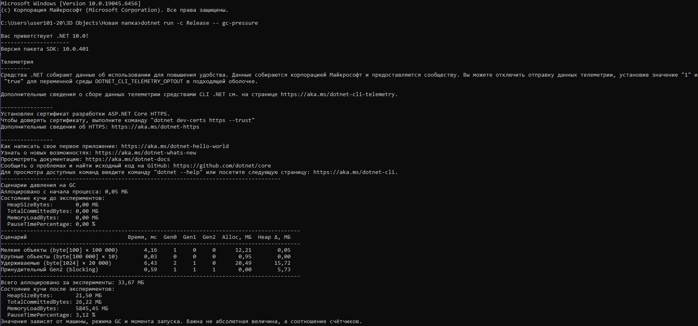
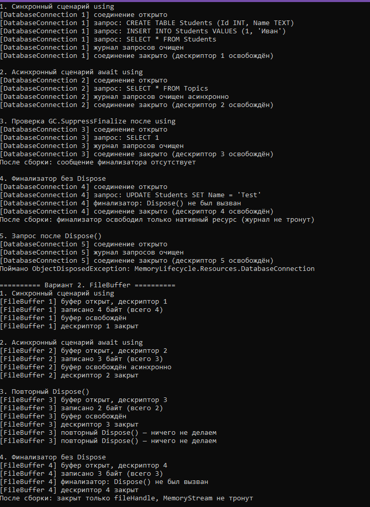

<div align="center">

# 🧠 MemoryLifecycle

**Исследование жизненного цикла объектов в .NET 10: от сборщика мусора до освобождения ресурсов**


</div>

---

## 📌 О проекте

Консольное приложение по дисциплине «Язык программирования C#». Проект
последовательно исследует жизненный цикл объектов: как сборщик мусора
распределяет объекты по поколениям и как корректно освобождать управляемые и
нативные ресурсы.

| КТ | Тема | Вариант | Статус | Отчёт |
|:--:|---|---|:--:|:--:|
| **40** | GC в .NET 10: поколения, регионы памяти (DATAS) | 2 — «Измерение давления» | ✅ | [01-gc.md](docs/01-gc.md) |
| 41 | Параллельная и фоновая сборка мусора | — | ⏳ | — |
| 42 | Финализируемые объекты. IDisposable. using | — | ⏳ | — |
| **43** | Паттерн Dispose. IAsyncDisposable | 1 — «Соединение с БД» (+ вариант 2) | ✅ | [04-dispose-pattern.md](docs/04-dispose-pattern.md) |

## 🛠 Стек и окружение

- **.NET 10 SDK** (проверка: `dotnet --version`)
- **C# 14**, nullable-ссылочные типы включены
- Дополнительные NuGet-пакеты не требуются
- Git, GitHub

## 📁 Структура

```text
MemoryLifecycle/
├── MemoryLifecycle.csproj
├── Program.cs              # точка входа и диспетчер команд
├── Gc/                     # КТ 40 — снимки счётчиков и сценарии нагрузки
│   ├── GcSnapshot.cs
│   ├── GcObserver.cs
│   └── PressureScenarios.cs
├── Resurces/               # классы, управляющие ресурсами
│   ├── DatabaseConnection.cs   # КТ 43, вариант 1
│   ├── FileBuffer.cs           # КТ 43, вариант 2
│   └── LogFile.cs
├── Demos/                  # консольные сценарии
│   ├── DisposeDemos.cs         # КТ 43
│   └── ResourceDemos.cs
└── docs/                   # отчёты по темам
    ├── 01-gc.md
    ├── 04-dispose-pattern.md
    └── img/                    # скриншоты вывода
```

## 🚀 Сборка и запуск

Все команды выполняются из корня репозитория.

```bash
dotnet build -c Release

dotnet run -c Release -- gc-pressure   # КТ 40: давление на GC
dotnet run -c Release -- dispose       # КТ 43: Dispose / IAsyncDisposable
dotnet run -c Release -- all           # все демонстрации
```

---

## 📊 КТ №40. Поколения и давление на кучу

Четыре сценария, каждый в отдельном методе; счётчики снимаются **до и после**
сценария через `GcSnapshot`.

**Условия запуска:** Windows 10 (build 19045.6456), .NET SDK 10.0.401, конфигурация `Release`, Workstation GC (по умолчанию).

| Сценарий | Время, мс | Gen0 | Gen1 | Gen2 | Alloc, МБ | Heap Δ, МБ |
|---|---:|---:|---:|---:|---:|---:|
| Мелкие объекты (`byte[100]` × 100 000) | 4,16 | 1 | 0 | 0 | 12,21 | 0,05 |
| Крупные объекты (`byte[100 000]` × 10) | 0,03 | 0 | 0 | 0 | 0,95 | 0,00 |
| Удерживаемые (`byte[1024]` × 20 000) | 6,43 | 2 | 1 | 0 | 20,49 | 15,72 |
| Принудительный Gen2 (blocking) | 0,59 | 1 | 1 | 1 | 0,00 | 5,73 |

<details>
<summary>📸 Скриншот вывода</summary>



</details>

**Выводы**

- 🟢 **Gen0** нагружают короткоживущие мелкие объекты: 12,21 МБ аллокаций дали одну сборку Gen0, а куча почти не выросла — объекты умерли молодыми.
- 🔵 **Gen2** нагружают долгоживущие данные: удерживаемые объекты пережили сборки (Gen0 +2, Gen1 +1) и увеличили кучу на 15,72 МБ.
- 🟣 **LOH** не вызывает немедленной сборки: 0,95 МБ в массивах ≥ 85 000 байт ушли сразу в LOH, Gen0 и Gen2 остались 0 — счётчик Gen2 растёт только при реальной сборке Gen2.
- ⚪ Полная сборка Gen2 одновременно увеличивает Gen0, Gen1 и Gen2 на единицу.

➡️ Подробно: [docs/01-gc.md](docs/01-gc.md)

---

## 🧹 КТ №43. Паттерн Dispose и IAsyncDisposable

`DatabaseConnection` и `FileBuffer` реализуют `IDisposable` + `IAsyncDisposable`
с полным паттерном:

```text
Dispose()        → Dispose(true)  + GC.SuppressFinalize   управляемое + нативное
DisposeAsync()   → DisposeAsyncCore() → finally Dispose(false) + GC.SuppressFinalize
~Finalizer()     → Dispose(false)                          только нативное
```

| Сценарий | Что показывает |
|---|---|
| `using` | синхронное освобождение: журнал очищен → соединение закрыто |
| `await using` | асинхронная очистка журнала, затем закрытие дескриптора |
| `using` + `GC.Collect()` | финализатор **не** вызывается — работает `SuppressFinalize` |
| без `Dispose()` | финализатор закрывает **только** дескриптор, журнал не трогает |
| вызов после `Dispose()` | `ObjectDisposedException` |
| повторный `Dispose()` (`FileBuffer`) | идемпотентность: ничего не происходит |

<details>
<summary>📸 Скриншоты вывода</summary>



</details>

**Выводы**

- `Dispose()` освобождает ресурс **детерминированно**, финализатор — нет и служит лишь страховкой.
- `Dispose(bool disposing)` разделяет управляемые и нативные ресурсы: из финализатора управляемые объекты трогать нельзя.
- `GC.SuppressFinalize` нужен и в `Dispose()`, и в `DisposeAsync()` — иначе объект зря попадёт в очередь финализации.
- `await using` освобождает ресурсы с асинхронным I/O без блокировки потока; `finally` гарантирует закрытие нативного ресурса даже при исключении.

➡️ Подробно: [docs/04-dispose-pattern.md](docs/04-dispose-pattern.md)

---

## 📜 История коммитов

Полная история: [commits/master](https://github.com/Tlordo/MemoryLifecycle/commits/master)

## 👤 Автор

**Глаголев Олег Евгеньевич**, группа 10924-2

